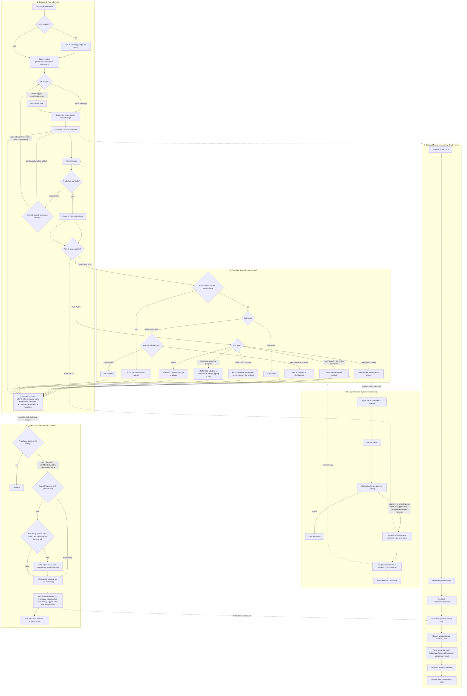

# How Cartographer operates — one connected map

Fixed from the pasted draft on 2026-11-16: the tool-result path loops back into the next request (it does not fall through to resting), `return` is refused in the main agent and belongs to the task, the handoff question is opt-in and off by default, the network boundary is the sandbox and not the gate, and every id used in a cross-subgraph edge now exists. The prior prose review lives in git history (`d971a97..8e22a1d`). Mermaid; GitHub renders it.

## Reading notes

- **The loop that matters:** `BUILD_REQ → SERVER → REPLY` and either straight back to `BUILD_REQ` via `onYield`, or out through the gate into `AFTER` and back to `BUILD_REQ`. `REST` is only ever reached when a stretch ends (`sleep`, a limit, a same-note run, a wake-quiet turn); a turn does not end at a plain reply.
- **The gate never refuses on network.** The main agent's inline commands run in the read-only window (no network, read-only mounts — decision O5); a command that must write or reach the network is a change item for a task, not a gate refusal. File create/edit/remove is refused twice: `beforeTool` (change tools) and `book` (file mutations outside a change task carrying the authorized `planItem`).
- **`/yolo` is a session switch**, not an answer in the Requests view; nothing ever waits for approval while it is on. The mechanical gates stay regardless.
- **The state block is not identical for the two conversations**: wakes ride the main agent's copy only; a focus gets its own fullness count, shelf line and the requests that wait for it. The newest successful reply's read batch stands together at the very end of the request, after every block; replacing it is a transient-tail eviction, never a collapse.
- **Collapse honesty:** the handoff question is opt-in (`handoffQuestion`); with it off, nothing asks the model anything — the front block is assembled by the harness. `afterMainCall` decides it after a round of tool results, and since 2026-11-16 the plain-reply path ends the stretch at the same line; the rest path collapses it mechanically (`docs/design.md` §7).
- **Plan edits are orchestrator-only**, enforced in `book` rather than by this diagram; and only the orchestrating context may call `task` (a focus cannot start one).
- **The screen's view of a request is its own rebuilt replay**, not the captured payload; both builds call the same `dressRequest`, the live one alone consumes wakes and window notices, and `test/unit.mjs` pins the byte-equality. If the flow ever disagrees with a live run, the live run wins and the chart is wrong.
