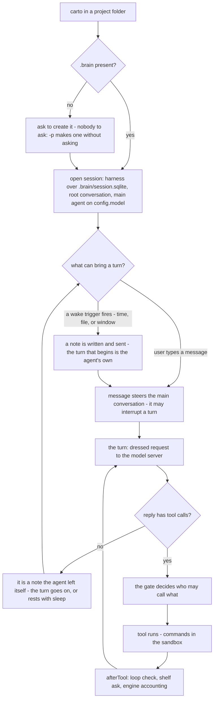
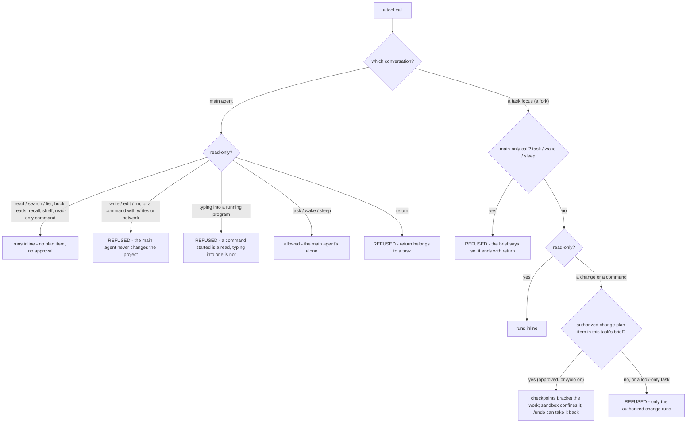
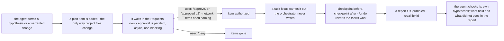
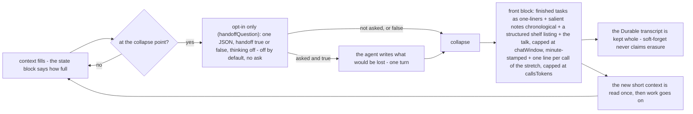

# How Cartographer operates — a flow review

A structural read of the codebase as of `254fe41` (2026-11-16). Not a substitute for the README (the harness as it is) and `docs/design.md` (the intent) — this is the wiring: what runs, in what order, and what is allowed to touch what. Where the code and the design intent differ, that is said here rather than smoothed over.

## The one-paragraph version

`carto` in a project folder opens a session: a Durable harness over `.brain/session.sqlite`, one root conversation (the **main agent**) on your model server, with a flat list of tools shared byte-for-byte with every **task** conversation forked from it (so the server's prefix cache holds). The agent is driven by turns: a user message or a wake note starts one, the model reads the dressed request, calls tools or doesn't, and the request/response cycle runs until the stretch ends (a `sleep`, a `return`, a limit, or a same-note run). Reads are inline for everyone; writes exist only inside a change **task** carrying an authorized plan item — with checkpoints, the sandbox and `/undo`. The context fills mechanically and, when it is full, is collapsed to a known keep-set (no model summarization). The brain in `.brain/` is the memory; the request is a cache rebuilt from it each step.

## 1. The big picture — session and turn lifecycle

Facts to read with the chart:

- The main agent **initiates**: on start and after every wake with nothing owed. It rests only with `sleep`, and only after a written checklist (nothing waiting in Requests, no wake owed, no approved plan item open, no untested ledger hypothesis, the atlas/commission done).
- A reply cut off at the output limit is not continued by the harness — the screen tells the user, who decides. For a task, the same cut is its end.
- A turn that a wake started in which the agent did nothing (or only `sleep`) is "quiet" and is left out of later requests once a newer wake overtakes it (`src/wake.mjs`).
- `onYield` bounds every stretch: same note repeated `LOOP_MAX` times ends it; per-stretch reply counts (`mainTurns` / `taskTurns`) end it otherwise. Wake notes continue; `sleep` rests.

## 2. One request, before the model reads it

Nothing added here is stored in the conversation; the stored transcript is the truth, the request is the view.

```mermaid
flowchart LR
    P["prepend - your own markdown, read fresh each request"] --> PRE["preamble - the charter and tool sections, cached prefix"]
    PRE --> TOP["copied top block - the assessment and the graph"]
    TOP --> FRONT["front block - what the last collapse kept, minute-stamped"]
    FRONT --> MSGS["the messages since - reads beyond the newest are one line each"]
    MSGS --> STATE["state block - at the end of the last message: context fill, shelf, ledger, plan, approval, requests, wakes, focus"]
    STATE --> WIN["windows block - shell windows as they are now"]
    WIN --> READ["the newest read - content at the very end, after everything"]
    READ --> SERVER["the model server"]
```

- The same flat tool list is sent byte for byte to the main agent and every task fork, so the server never re-reads a differing prefix.
- Per request, `dressRequest` also: drops overtaken quiet wake turns, collapses superseded reads to one line, folds dropped reports, strips the handoff-ask markup, and — for a task — appends a one-shot note, and strips a task's own finished steps to one block leaving large results marked by id and size.
- The state block is an ending of the *last* message only; the newest read stands after it, and only the windows block may sit between them. A task gets its own copy of the block (its own fullness count, its own shelf line, the requests that wait) — wakes alone stay the main agent's.

## 3. The gate — who may call what, decided per call

Additional gate rules enforced in the same hooks (`src/harness.mjs`):

- One file read comes back per reply; a further read in the same reply is refused, and the question that follows asks whether the lot should be shelved (the shelf ask).
- The plan is changed by the orchestrating context only — a task can never edit it.
- `sleep`/`wake` are orchestrator-only; no nesting of foci (a task cannot start a task).
- A change task's commands run in the sandbox (bubblewrap): project root confined, brain and `.git/` read-only for change tasks, network only when its item says so. Read-only commands for the main agent run in the read-only profile (decision O5, 2026-11-15) — enforced by the sandbox, not by discipline.
- The same call failing `LOOP_MAX` times in a row ends the turn as a loop; the failure and its error ride the results for the screen and the task machinery.

## 4. The change lifecycle — from hypothesis to undo

Default mode: an item waits for you, and the agent does everything that does not depend on it. Yolo mode: approval is off, the agent's judgment governs — but the mechanical gates (confinement, sandbox, checkpoints, `.brain/`/`.git/` protection) are unchanged. `/undo` and `/approve` are user commands; the user can equally steer with their own words, or edit any artifact by hand — both doors (user and agent) act on the same brain.

## 5. The context's life — fill, collapse, keep

- The collapse is decided in `afterMainCall`, after a round of tool results, once they have all come back — never on a plain reply. The fullness check runs there and the collapse rides the round's last result.
- The handoff question is opt-in (`handoffQuestion`, decision O1); with it off the collapse carries the last reply mechanically, with no ask. Either way, no model writes any of the keep-set — it is what the harness knows to keep.
- The context is a cache: the ledger, plan, atlas, assessment, reports and the transcript are never inside it in full — a collapse cannot touch them. What is in the front block is a projection of them.
- Folds (`book context fold`) shrink mid-session what is carried; recall brings back by id. The state block shows what stands in full, with ids and token counts.

## 6. What the user's side looks like

- The full-screen tabs: Chat (the dyad, word for word, editable by both parties), Carto (ledger/plan/atlas rows with the same verbs the agent has), Diff (what changed, `/diff`, `/undo`), Shells (persistent escape hatches), Context (the request the agent was sent, part by part, in reading order).
- Requests is the one place approvals gather: `/requests`, `/approve`, `/deny`, `/answer` — or plain words ("yes", "approved p1"), which the harness reads as an approval only when they are unambiguous, and named only item-by-item.
- The user edits any brain artifact by hand or through the screen; the agent sees hand edits at the next step. The brain is a shared thing; the relationship is a dyad.
- The screen and the agent are meant to be two doors over the same operation engine. Today the chat/context/shell surfaces are bespoke and the ops layer (`src/ops.mjs`, the `book` capability table) is shared for many rows but not all — full parity is the design direction (§8 of the design doc), not a shipped fact.

## 7. Standing gaps and disclaimers

- MCP: not present anywhere, in any direction — no server, no client (`grep -ri mcp` comes up empty).
- The trace/`CARTO_TRACE` log and `live_logs/` exports are measurement tools, not runtime truth; the Context tab is the honest in-app view of a request.
- Live behavior against a real model is deliberately scarce; most of the machinery above is verified offline (tests, stub probes). Anything about model *behavior* in this review is the prompt and the harness as written, not a measurement.
- What I read for this review: `src/harness.mjs`, `src/engine.mjs`, `src/context.mjs`, `src/request.mjs`, `src/state.mjs`, `src/wake.mjs`, `src/requests.mjs`, the tool surfaces, and the top of `src/index.mjs`/`src/cli.mjs`. What I did not re-read line by line: the screen's renderers, `src/sandbox.mjs`, `src/windows.mjs`, `src/trace.mjs` — for those, the charts describe their call sites and the design doc, not an independent audit.
- The five charts are Mermaid; GitHub renders them, many viewers don't. If they arrive as bare source, every section above it stands alone as text.
